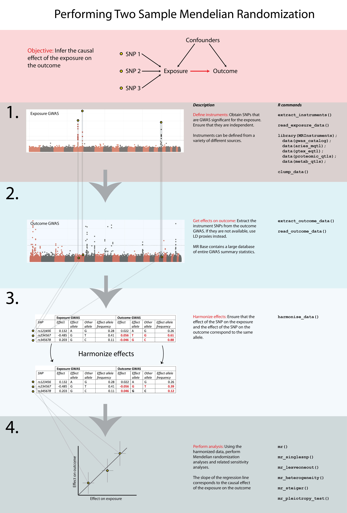

```{r, include = FALSE}
knitr::opts_chunk$set(
  collapse = TRUE,
  comment = "#>",
  fig.align = 'center'
)
```

## Background

Two sample Mendelian randomisation is a method to estimate the causal effect of an exposure on an outcome using only summary statistics from genome wide association studies (GWAS). Though conceptually straightforward, there are a number of steps that are required to perform the analysis properly, and they can be cumbersome. The TwoSampleMR package aims to make this easy by combining three important components

- data management and harmonisation
- the statistical routines to estimate the causal effects
- connection to a large repository of the actual GWAS summary statistics needed to perform the analyses.

The general principles [@DaveySmith2003; @DaveySmithHemani2014], and statistical methods [@Pierce2013; @Bowden2015] can be found elsewhere, here we will just outline how to use the R package.

This package uses the [opengwasr](https://github.com/opengwas/opengwasr) package to connect to the OpenGWAS database of thousands of complete GWAS summary data.

## Installation

If you are using macOS or Windows you can install a binary version of TwoSampleMR from our <https://mrcieu.r-universe.dev> with the following code.

```{r eval=FALSE}
install.packages("TwoSampleMR", repos = c("https://mrcieu.r-universe.dev", "https://cloud.r-project.org"))
```

If you are using the latest long term support version of Ubuntu Linux (currently 24.04 Noble Numbat) you can install a binary version of TwoSampleMR with the following code.

```{r eval=FALSE}
options(HTTPUserAgent = sprintf(
  "R/%s R (%s)",
  getRversion(),
  paste(getRversion(),
        R.version["platform"],
        R.version["arch"],
        R.version["os"])
))

install.packages(
  'TwoSampleMR',
  repos = c(
    'https://mrcieu.r-universe.dev/bin/linux/noble/4.5/',
    'https://p3m.dev/cran/__linux__/noble/latest',
    'https://cloud.r-project.org'
  )
)
```

To install TwoSampleMR from source from our GitHub repository run the following code.

```{r eval=FALSE}
# install.packages("remotes") # Run if remotes package not installed
library(remotes)
install_github("MRCIEU/TwoSampleMR")
```

TwoSampleMR can be installed in [WebR](https://docs.r-wasm.org/webr/latest/) using the following code.

```{r eval=FALSE}
install.packages('TwoSampleMR',
  repos = c('https://mrcieu.r-universe.dev', 'https://repo.r-wasm.org'))
```

## Overview

The workflow for performing MR is as follows:

1. Select instruments for the exposure (perform LD clumping if necessary)
2. Extract the instruments from the [OpenGWAS database](https://opengwas.io) for the outcomes of interest
3. Harmonise the effect sizes for the instruments on the exposures and the outcomes to be aligned to the same reference allele
4. Perform MR analysis, sensitivity analyses, create plots, compile reports

A diagrammatic overview is shown here:

```{r echo=FALSE, fig.alt="A diagrammatic overview of performing a two-sample Mendelian randomization analysis", out.width="800px"}

```

A basic analysis, e.g. the causal effect of body mass index on coronary artery disease, looks like this:

```{r eval=FALSE}
library(TwoSampleMR)

# List available GWASs
ao <- available_outcomes()

# Get instruments
exposure_dat <- extract_instruments("ukb-b-19953")

# Get effects of instruments on outcome
outcome_dat <- extract_outcome_data(snps = exposure_dat$SNP, outcomes = "ebi-a-GCST003116")

# Harmonise the exposure and outcome data
dat <- harmonise_data(exposure_dat, outcome_dat)

# Perform MR
res <- mr(dat)
```

Each step is documented on other pages in the documentation.

## Authentication

The statistical methods in TwoSampleMR can be used on any data, but there are a number of functions that connect to the OpenGWAS database for data extraction. These OpenGWAS data access functions require authentication.

TwoSampleMR reads OpenGWAS through the [opengwasr](https://github.com/opengwas/opengwasr) package, which finds your token in the `OPENGWAS_JWT` environment variable. See `vignette("opengwasr", package = "opengwasr")` for how to get a token and set it, and for checking that it works. The data functions take a `src` argument, an opengwasr Source, if you need more control than the default `opengwasr::og_api()` gives.

## What has changed in version 0.8.0

- The effects of continuous traits are per SD of the trait, so the MR estimate of a continuous exposure is per SD of the exposure.
- Analyses are named `<store_id>:<analysis_id>`, and variants without an rsID are named by their ALID, on GRCh38.
- Instruments are clumped in an LD reference whose ancestry matches the study's, at its own thresholds (the old 0.001 within 10,000 kb is refused).
- Imputed Associations replace LD proxies.
- The old OpenGWAS R client is no longer used. `ldsc_h2()` and `ldsc_rg()` are not available until opengwasr can serve them.

See the NEWS for details.

## References
